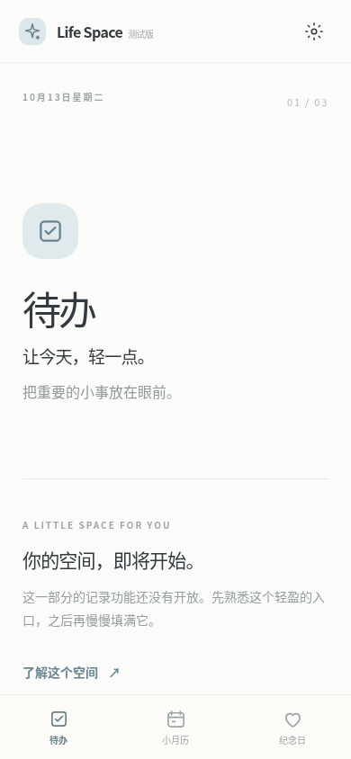
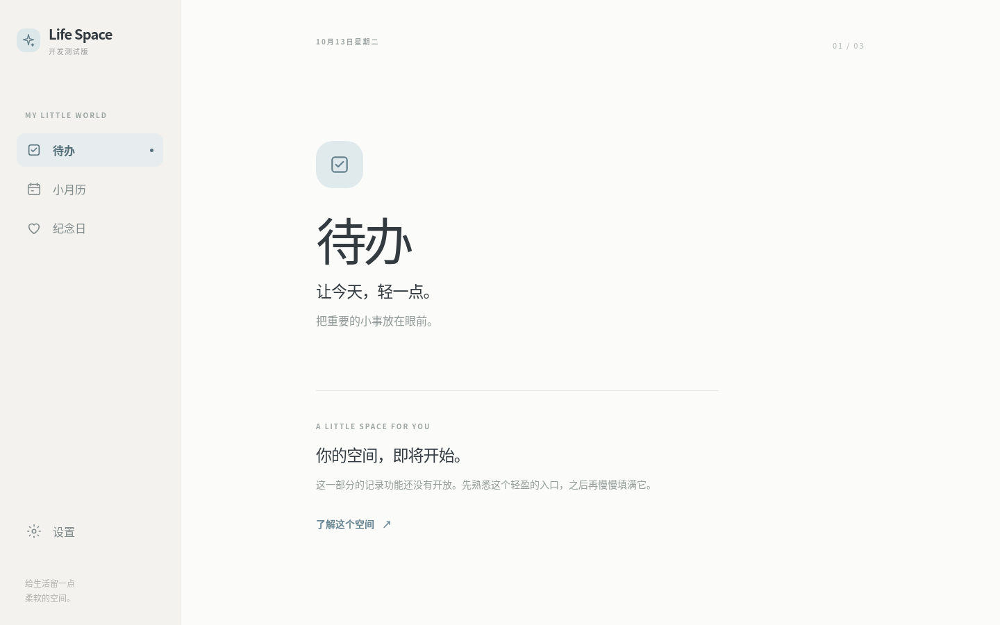

# Life Space · Foundation

Life Space 是开发阶段暂用显示名。当前仅有应用外壳、三个占位空间和 Android 测试包基础；正式名称、包名与持久签名尚未确定。

## 本地运行

需要 Node.js 20.19+ 和 npm。运行 `npm ci`、`npm run dev`。检查使用 `npm run typecheck`、`npm run lint`、`npm test`、`npm run build`。在配置了 Android SDK 与 JDK 21 的环境中，运行 `npm run build && npx cap sync android && cd android && ./gradlew assembleDebug`；APK 位于 `android/app/build/outputs/apk/debug/app-debug.apk`。

PR 的 GitHub Actions 执行相同检查并上传测试 APK artifact，包含 `BUILD-INFO.txt` 与 SHA-256。测试包 ID 为 `com.lifespace.foundation.test`，版本为 `0.1.0-test.1`（versionCode 1）。它采用 CI 的 Debug 签名，不是正式更新签名；不同运行间签名可能改变，届时需卸载重装，卸载会清除本地数据。正式发布前需确定持久包名和签名。本阶段请勿用于保存真实记录。

## 当前行为

手机底部固定三个 Tab，桌面左栏导航；设置独立打开。首次从待办开始，之后仅恢复上次选中的模块。运行内各模块保留各自子页与滚动位置；重启后不恢复子页或弹窗。浏览器后退按弹窗、设置、子页层级返回，Tab 切换本身不产生历史项；根页面后退遵循浏览器默认导航。Android 返回键在根页面 1.8 秒内连按两次退出，进入子层或切换 Tab 会重置该窗口。

本地 IndexedDB 版本升级入口位于 `src/shared/storage/database.ts`。设置与模块命名空间独立，模块存储暂不规定业务数据结构。无法读取或保存本地设置时界面会显示错误。Android 禁用系统自动备份。

当前配色：奶白 `#f8f7f3`、雾蓝 `#e0eaed`、柔粉 `#f3e5e7`、暖杏 `#f4e8d9`。安全区在 Web 使用 CSS inset，在 Android 由原生 system bars 与 display cutout Insets 处理。Android 真机上的三键导航、手势导航与异形屏仍需用户安装验收。

## 预览与验证

`npm run verify:browser` 在本地启动的生产预览 `http://127.0.0.1:4173/` 上使用 Playwright Chromium 检查模块滚动保持、子页返回、前进历史、Service Worker 控制与离线刷新，并更新截图。首次运行可执行 `npx playwright install chromium`；若使用系统 Chromium，可设 `LIFE_SPACE_CHROMIUM_PATH`。其他环境可用 `LIFE_SPACE_PREVIEW_URL` 指定地址。

测试记录见 [docs/verification.md](docs/verification.md)。
